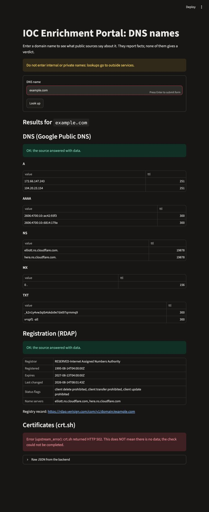

# Milestone log

## Milestone 0: design
- Pull request: #1 "Milestone 0: design.md for the simple IOC portal"

## Milestone 1: thinnest slice (Google DNS only)
- Branch: `feat/milestone-1`
- Source: Google Public DNS over HTTPS (keyless). Python 3.14.7, Flask 3.1.3, requests 2.34.2, Streamlit 1.67.0. No async anywhere.

### Definition of done (design.md section 9)
| Check | Result |
|---|---|
| Backend returns the source's data for a valid name, per the contract | yes, evidence 1 |
| An invalid name returns a clear error, not a crash | yes, evidence 3 |
| The page shows the result for a typed name, using only the backend | yes, evidence 2 |
| README explains install and run for both parts | yes |
| No key or token in any commit | none exist; the repository was scanned |
| Merged into `main` through a pull request | see the pull request below |

### Evidence 1: a real request and the JSON it returned
```
$ curl -s -i http://127.0.0.1:8010/api/v1/domain/Example.com      -> HTTP 200
```
```json
{
  "ioc": {
    "type": "domain",
    "input": "Example.com",
    "value": "example.com"
  },
  "sources": {
    "dns": {
      "status": "ok",
      "data": {
        "resolver": "dns.google",
        "rcode": "NOERROR",
        "A": [
          { "value": "104.20.23.154", "ttl": 300 },
          { "value": "172.66.147.243", "ttl": 300 }
        ],
        "AAAA": [
          { "value": "2606:4700:10::ac42:93f3", "ttl": 300 },
          { "value": "2606:4700:10::6814:179a", "ttl": 300 }
        ],
        "NS": [
          { "value": "hera.ns.cloudflare.com.", "ttl": 21600 },
          { "value": "elliott.ns.cloudflare.com.", "ttl": 21600 }
        ],
        "MX": [
          { "value": "0 .", "ttl": 121 }
        ],
        "TXT": [
          { "value": "_k2n1y4vw3qtb4skdx9e7dxt97qrmmq9", "ttl": 300 },
          { "value": "v=spf1 -all", "ttl": 300 }
        ]
      }
    }
  }
}
```
(Whitespace reformatted; values are exactly what the backend returned.)

### Evidence 2: the page, showing the same name


### Evidence 3: invalid names
```
$ curl -s -i http://127.0.0.1:8010/api/v1/domain/10.0.0.1          -> HTTP 400
{"error":"not a valid DNS name: 10.0.0.1 (IP addresses are not accepted)","input":"10.0.0.1"}

$ curl -s -i "http://127.0.0.1:8010/api/v1/domain/not%20a%20name"  -> HTTP 400
{"error":"not a valid DNS name: not a name (URLs, ports, e-mail addresses and spaces are not accepted)","input":"not a name"}
```
Also checked: a pasted URL, `localhost` and `example.123` all return 400; `Example.com` is cleaned to `example.com`; `bücher.de` becomes `xn--bcher-kva.de`;
an unknown route and an empty name return 404 in the same error format; a name that does not exist returns 200 with `"dns": {"status": "not_found"}`.

### A source that cannot be reached
Started with `DNS_URL=http://127.0.0.1:9/ BACKEND_PORT=8011 python -m backend.app` (an address where nothing listens): HTTP 502
`{"error":"all sources failed", ... "error":{"code":"upstream_error","message":"could not reach Google DNS: ConnectionError"}}`.

### Pull request
#2 "Milestone 1: thinnest slice (Google DNS, Flask backend, Streamlit page)": https://github.com/NewCooDooer/ioc-simple-dns/pull/2

## Milestone 2: three sources and recorded offline tests
- Branch: `feat/milestone-2`
- Sources: Google DNS, RDAP (rdap.org), crt.sh. All keyless; no key or token anywhere. Still no async: the sources are asked one after another.

### Definition of done (design.md section 9)
| Check | Result |
|---|---|
| One response holds a result from each of three real sources | yes, evidence 1 |
| A failing source still returns the other two, with its error shown; all failing gives 502 | yes, evidence 3 and the tests |
| Tests replay recordings and pass with the network off | yes, evidence 2 (36 passed, also under an operating-system network block) |
| Tests cover a hit, an unknown name and a source error | yes, `tests/test_api.py` |
| No key in any recording or commit | yes: recordings hold only address, status and body; scanned for key/token/authorization/e-mail |
| `design.md` and README match the code | yes, updated in this pull request |
| Merged to `main` through a pull request | see the pull request below |

### Evidence 1: the backend's JSON for one name, with all three sources
```
$ curl -s -m 150 http://127.0.0.1:8010/api/v1/domain/example.com      -> HTTP 200 (about 14 s; crt.sh is slow)
```
<details><summary>Show the full JSON (all three sources <code>ok</code>)</summary>

```json
{
  "ioc": {
    "type": "domain",
    "input": "example.com",
    "value": "example.com"
  },
  "sources": {
    "dns": {
      "status": "ok",
      "data": {
        "resolver": "dns.google",
        "rcode": "NOERROR",
        "A": [
          { "value": "172.66.147.243", "ttl": 300 },
          { "value": "104.20.23.154", "ttl": 300 }
        ],
        "AAAA": [
          { "value": "2606:4700:10::6814:179a", "ttl": 300 },
          { "value": "2606:4700:10::ac42:93f3", "ttl": 300 }
        ],
        "NS": [
          { "value": "elliott.ns.cloudflare.com.", "ttl": 21600 },
          { "value": "hera.ns.cloudflare.com.", "ttl": 21600 }
        ],
        "MX": [
          { "value": "0 .", "ttl": 202 }
        ],
        "TXT": [
          { "value": "_k2n1y4vw3qtb4skdx9e7dxt97qrmmq9", "ttl": 300 },
          { "value": "v=spf1 -all", "ttl": 300 }
        ]
      }
    },
    "rdap": {
      "status": "ok",
      "data": {
        "registrar": "RESERVED-Internet Assigned Numbers Authority",
        "registered": "1995-08-14T04:00:00Z",
        "expires": "2027-08-13T04:00:00Z",
        "last_changed": "2026-08-14T08:01:43Z",
        "statuses": [
          "client delete prohibited",
          "client transfer prohibited",
          "client update prohibited"
        ],
        "nameservers": [
          "elliott.ns.cloudflare.com",
          "hera.ns.cloudflare.com"
        ],
        "registry_url": "https://rdap.verisign.com/com/v1/domain/example.com"
      }
    },
    "crtsh": {
      "status": "ok",
      "data": {
        "certificate_count": 49,
        "first_seen": "2010-09-02T16:36:49",
        "last_seen": "2026-10-20T21:19:03",
        "issuers": [
          "C=GB, O=Sectigo Limited, CN=Sectigo Public Server Authentication CA DV E36",
          "C=GB, O=Sectigo Limited, CN=Sectigo Public Server Authentication CA DV R36",
          "C=GB, O=Sectigo Limited, CN=Sectigo Public Server Authentication CA OV R36",
          "C=GB, ST=Cymru, O=AS207960 Cyfyngedig, OU=AS207960 Department of Random Numbers, CN=AS207960 Test CA",
          "C=GB, ST=Greater Manchester, L=Salford, O=Sectigo Limited, CN=Sectigo ECC Organization Validation Secure Server CA",
          "C=GB, ST=Greater Manchester, L=Salford, O=Sectigo Limited, CN=Sectigo RSA Domain Validation Secure Server CA",
          "C=NL, O=eMudhra BV, CN=EM DV TLS CA - G3B",
          "C=US, O=\"CLOUDFLARE, INC.\", CN=Cloudflare TLS Issuing ECC CA 1",
          "C=US, O=\"CLOUDFLARE, INC.\", CN=Cloudflare TLS Issuing RSA CA 1",
          "C=US, O=\"thawte, Inc.\", CN=thawte SSL CA - G2"
        ],
        "names": [
          "*.example.com",
          "AS207960 Test Intermediate - example.com",
          "dev.example.com",
          "emudhra-lab.example.com",
          "example.com",
          "m.example.com",
          "m.testexample.com",
          "products.example.com",
          "subjectname@example.com",
          "support.example.com",
          "user@example.com",
          "www.example.com"
        ],
        "names_truncated": false
      }
    }
  }
}
```
</details>

(The crt.sh `names` list is raw certificate data, so it includes a few placeholder e-mail style names on the reserved `example.com` domain. These came from the live answer; the saved recordings had e-mail-bearing rows removed.)

### Evidence 2: test output with the network off
```
$ sandbox-exec -p "(version 1)(allow default)(deny network*)" .venv/bin/python -m pytest -v
platform darwin -- Python 3.14.7, pytest-9.2.0, pluggy-1.7.0 -- ioc-simple/.venv/bin/python
collecting ... collected 36 items
tests/test_api.py::test_a_known_name_returns_all_three_sources PASSED
tests/test_api.py::test_the_dns_data_matches_the_recording PASSED
tests/test_api.py::test_rdap_follows_the_recorded_redirect PASSED
tests/test_api.py::test_the_crtsh_summary PASSED
tests/test_api.py::test_an_unknown_name_is_not_found_everywhere_but_still_200 PASSED
tests/test_api.py::test_a_recorded_real_crtsh_502_shows_an_error_and_keeps_the_other_sources PASSED
tests/test_api.py::test_simulated_timeout_is_reported_as_timeout PASSED
tests/test_api.py::test_simulated_unreadable_answer_is_invalid_response PASSED
tests/test_api.py::test_simulated_all_sources_failing_returns_502 PASSED
tests/test_api.py::test_an_invalid_name_is_400_and_no_outside_service_is_contacted PASSED
tests/test_api.py::test_health_and_unknown_address PASSED
tests/test_offline.py::test_real_network_connections_are_blocked PASSED
tests/test_validate.py::test_good_names_are_cleaned[example.com-example.com] PASSED
tests/test_validate.py::test_good_names_are_cleaned[Example.COM-example.com] PASSED
tests/test_validate.py::test_good_names_are_cleaned[  example.com. -example.com] PASSED
tests/test_validate.py::test_good_names_are_cleaned[login.example.com-login.example.com] PASSED
tests/test_validate.py::test_good_names_are_cleaned[_dmarc.example.com-_dmarc.example.com] PASSED
tests/test_validate.py::test_good_names_are_cleaned[b\xfccher.de-xn--bcher-kva.de] PASSED
tests/test_validate.py::test_good_names_are_cleaned[xn--bcher-kva.de-xn--bcher-kva.de] PASSED
tests/test_validate.py::test_bad_names_are_refused[] PASSED
tests/test_validate.py::test_bad_names_are_refused[   ] PASSED
tests/test_validate.py::test_bad_names_are_refused[10.0.0.1] PASSED
tests/test_validate.py::test_bad_names_are_refused[2001:db8::1] PASSED
tests/test_validate.py::test_bad_names_are_refused[localhost] PASSED
tests/test_validate.py::test_bad_names_are_refused[https://example.com] PASSED
tests/test_validate.py::test_bad_names_are_refused[user@example.com] PASSED
tests/test_validate.py::test_bad_names_are_refused[example.com:8080] PASSED
tests/test_validate.py::test_bad_names_are_refused[not a name] PASSED
tests/test_validate.py::test_bad_names_are_refused[-bad.example.com] PASSED
tests/test_validate.py::test_bad_names_are_refused[bad-.example.com] PASSED
tests/test_validate.py::test_bad_names_are_refused[a..b.com] PASSED
tests/test_validate.py::test_bad_names_are_refused[exa$mple.com] PASSED
tests/test_validate.py::test_bad_names_are_refused[example.123] PASSED
tests/test_validate.py::test_bad_names_are_refused[aaaaaaaaaaaaaaaaaaaaaaaaaaaaaaaaaaaaaaaaaaaaaaaaaaaaaaaaaaaaaaaa.com] PASSED
tests/test_validate.py::test_bad_names_are_refused[typed15] PASSED
tests/test_validate.py::test_the_reason_is_in_the_error_message PASSED
tests/test_offline.py::test_real_network_connections_are_blocked
======================== 36 passed, 1 warning in 0.08s =========================
```
- The command runs the whole suite inside a macOS sandbox that makes the **operating system** refuse every network connection. The suite also enables `pytest-socket`,
  and `tests/test_offline.py` asserts that a real connection is blocked. Wi-Fi was not touched.
- The seven recordings in `tests/fixtures/` were saved from the real services by `python record.py` (address, status and body only; no headers).
  Three of 81 crt.sh certificate rows were removed because their names contained e-mail addresses (personal data); the file says so.
- **Real recordings:** a known name and an unknown name for each source, and a real crt.sh HTTP 502. **Simulated** (built by hand and labelled in the tests):
  a timeout, an unreadable answer, and all three sources failing, because a real service cannot be asked to fail on command.

### Evidence 3: one source fails, and how I made it fail
How: started the backend with crt.sh pointed at an address where nothing listens (the other two sources use their real addresses):
```
$ CRTSH_URL=http://127.0.0.1:9/ BACKEND_PORT=8011 python -m backend.app
$ curl -s -i http://127.0.0.1:8011/api/v1/domain/example.com
HTTP/1.1 200 OK
Server: Werkzeug/3.1.9 Python/3.14.7
Content-Type: application/json
Content-Length: 1128
Connection: close
```
```json
{
  "ioc": {
    "type": "domain",
    "input": "example.com",
    "value": "example.com"
  },
  "sources": {
    "dns": {
      "status": "ok",
      "data": "(same as evidence 1, omitted for length)"
    },
    "rdap": {
      "status": "ok",
      "data": "(same as evidence 1, omitted for length)"
    },
    "crtsh": {
      "status": "error",
      "data": null,
      "error": {
        "code": "upstream_error",
        "message": "could not reach crt.sh: ConnectionError"
      }
    }
  }
}
```
The request still succeeds (HTTP 200): DNS and RDAP return their data and crt.sh says why it failed.
The real crt.sh also failed on its own during testing (HTTP 502 and HTTP 404 several times, and ReadTimeout), and the page showed exactly that:


If all three sources fail, the answer is HTTP 502 (started with all three addresses dead):
```json
{
  "error": "all sources failed",
  "input": "example.com",
  "sources": {
    "dns": {
      "status": "error",
      "data": null,
      "error": {
        "code": "upstream_error",
        "message": "could not reach Google DNS: ConnectionError"
      }
    },
    "rdap": {
      "status": "error",
      "data": null,
      "error": {
        "code": "upstream_error",
        "message": "could not reach RDAP: ConnectionError"
      }
    },
    "crtsh": {
      "status": "error",
      "data": null,
      "error": {
        "code": "upstream_error",
        "message": "could not reach crt.sh: ConnectionError"
      }
    }
  }
}
```
(`HTTP/1.1 502 BAD GATEWAY
Server: Werkzeug/3.1.9 Python/3.14.7
Content-Type: application/json
Content-Length: 439
Connection: close`)

### Checks that the tests really catch problems (breaking the code on purpose)
| I broke... | The test that failed |
|---|---|
| the "all sources failed" rule (so it could never trigger) | `test_simulated_all_sources_failing_returns_502` |
| crt.sh's HTTP status check (so a 502 would be read as data) | `test_a_recorded_real_crtsh_502_shows_an_error_and_keeps_the_other_sources` |
| the IP-address rule in the name checker | `test_an_invalid_name_is_400_and_no_outside_service_is_contacted` and `test_the_reason_is_in_the_error_message` |

Each time the code was restored and all tests passed again.

### Observations while building
- crt.sh is unreliable: recording its three answers took about 20 minutes of retries; one good answer took 51 seconds, others timed out, and it returned 502 and 404 many times.
  The design already assumed this (own 60 s timeout; a failing source never hides the others).
- The page's crt.sh display for a successful answer was checked against the real saved JSON (49 certificates) with Streamlit's test runner, because crt.sh kept failing during the browser test.
- A lookup takes the **sum** of the three sources (14 s in the evidence run), the price of having no async code.

### Pull request
#3 "Milestone 2: three sources and recorded offline tests": https://github.com/NewCooDooer/ioc-simple-dns/pull/3

## Milestone 3: scores and verdict
- Branch: `add-scoring-and-verdict` (merged). Same stack as Milestone 2; new file `backend/scoring.py`.
- What it does: each source's result becomes a 0-100 score (0 = definitely malware, 100 = definitely not malware); the scores are averaged and rounded;
  the average gives one of three verdicts (0-40 likely malware, 41-60 undetermined, 61-100 likely safe). Rules and reasons: `design.md` section 4a.
- Decisions made with the project owner: three verdicts instead of the five first requested; a source that answers "not found" scores 50; a source with an
  error has no score and is left out of the average; **a firm verdict needs all three sources** (fewer than 3 scores always gives undetermined).

### Definition of done (design.md section 9)
| Check | Result |
|---|---|
| Every source has `score` and `score_reason`; the answer has `assessment`; old fields unchanged | yes, evidence 1 |
| Band edges (40/41, 60/61), each source's rules, a failing source, the all-failed case tested, with 3, 2 and 1 sources used | yes, evidence 2 |
| The page shows the three scores, the average, the verdict and the caveat | yes, checked in the browser (evidence 3) |
| `design.md` and the README match the code | yes |
| Merged into `main` through a pull request | yes, after an approving review by the collaborator |

### Evidence 1: a real request (data blocks left out to keep it short)
`curl -s http://127.0.0.1:8010/api/v1/domain/example.com`, run on 2026-11-09:
```json
{
  "ioc": {
    "type": "domain",
    "input": "example.com",
    "value": "example.com"
  },
  "sources": {
    "dns": {
      "status": "ok",
      "score": 60,
      "score_reason": "the name resolves to an address"
    },
    "rdap": {
      "status": "ok",
      "score": 90,
      "score_reason": "registered 5 years or more ago"
    },
    "crtsh": {
      "status": "ok",
      "score": 75,
      "score_reason": "first certificate issued 1 year or more ago"
    }
  },
  "assessment": {
    "score_min": 0,
    "score_max": 100,
    "average": 75,
    "sources_used": 3,
    "sources_total": 3,
    "verdict": "likely_safe",
    "verdict_label": "Likely safe",
    "verdict_note": null
  }
}
```

### Evidence 2: tests with the network off
```
$ pytest -q
56 passed, 1 warning
```
Includes the case that started the "all three sources" rule: scores 60 and 15 with crt.sh in error average 38, which alone would say "likely malware",
but with only 2 of 3 sources the verdict is capped at undetermined.

### Evidence 3: the page
On a run where crt.sh returned HTTP 502, the page showed **Undetermined**, average 75 from 2 of 3 sources, the warning "Only 2 of 3 sources gave a score, so the verdict cannot be
more than undetermined.", a table of the scores with a reason each (crt.sh: "no score"), and the caveat "This verdict is a rough guess from three weak signals, not a finding."

### Observations
- crt.sh failing often means firm verdicts are rarer than they look; the same name gave a 2-of-3 run and a 3-of-3 run on the same day.
- The scores are all about age, so a long-lived name that was taken over would still look safe. The verdict is a hint, not a finding.

### Pull request
#10 "Milestone 3: per-source scores, average and three-way verdict": https://github.com/NewCooDooer/ioc-simple-dns/pull/10

## Milestone 4: caching
- Branch: `feat/caching`
- In memory only (`backend/cache.py`); no new dependency; still no async and no database.

### Definition of done (design.md section 9)
| Check | Result |
|---|---|
| Each source has its own expiry, with reasons; Google follows its `Cache-Control` | yes, design.md section 11; evidence 1 |
| An error is never cached; "not found" is, for less time | yes, `tests/test_cache.py` |
| Spellings of one IOC share an entry; two IOCs never do; the key holds no secret | yes, `tests/test_cache.py` |
| A user can tell cached from fresh | yes, `X-Cache-Age-<source>` response headers (design.md section 4); the body is unchanged; the page shows the age |
| Existing tests keep their checks and pass; new tests cover hit, miss, expiry, uncached error, offline | yes: 53 passed (the original 36 plus 17 new); the only change to existing files is a fixture that empties the cache before each test |
| Fixed run of 20 or more lookups, counted before and after, no real quota | yes, evidence 2 |
| Merged to `main` through a pull request the owner reviews | **not yet: no pull request has been opened** |

### Evidence 1: what the sources said (checked 2026-11-06)
- Google APIs Terms section 5e: no "cached copies longer than permitted by the cache header". One real request each showed
  `Cache-Control: private, max-age=300` for `example.com` (A) and `max-age=900` for a name that does not exist.
- rdap.org: 10 requests per 10 s then 429; nothing about caching; its 302 says `public, max-age=28800`. The registry reply (rdap.verisign.com) sent no cache header.
- crt.sh: nothing on its own pages; the operator's 2020 post says 60 requests per IP per minute. A report of 5 per minute is unverified.
- Those four requests were the only real network use; the fixed run and the tests send none.

### Evidence 2: the fixed run (`python bench/run_benchmark.py before|after|compare`)
27 lookups: six spellings of `example.com`, repeats of three more names, a name that does not exist (three times), a name whose crt.sh lookup fails (three times),
two invalid inputs, and a closing repeat pass. A fake web replays the recordings; sockets are blocked. "Before" was run on the code without the cache (the new files set aside
and the changed ones stashed), with the same fake web as "after".

| Source | Before | After |
|---|---|---|
| Google DNS | 109 | 26 |
| RDAP (redirect hop included) | 50 | 12 |
| crt.sh | 25 | 8 |
| **Total** | **184** | **46** |

Both figures were worked out by hand first and matched the run (for example after: 26 DNS = 4 known names x 5, the failing-crt.sh name x 5, the unknown name x 1;
crt.sh 8 = 4 known names, the unknown name, and 3 uncached errors). `compare` also checked that every answer is unchanged (the body has no cache fields; the cache is reported in headers).
The run does not move time, so expiry is covered by the tests.

### Checks that the tests really catch problems (breaking the code on purpose)
| I broke... | Tests that failed |
|---|---|
| the cache so it stores errors | `test_a_crtsh_502_is_not_cached`, `test_the_cache_refuses_errors_and_zero_lifetimes`, `test_not_found_is_cached_but_for_less_time` |
| expiry (entries never expire) | the three expiry tests |
| the key (ignores the source) | 13 tests, including three of the original ones |
| DNS (ignores `Cache-Control`, keeps 1 hour) | `test_dns_is_kept_for_the_time_in_googles_cache_control_header`, `test_dns_without_a_cache_control_header_is_not_kept` |

Each time the code was restored (checked byte for byte) and all the tests passed again (52 at the time of these checks).

### Limits to know
- The cache lives in one backend process and is emptied on restart.
- The `ttl` inside cached DNS records is Google's value at fetch time, not counted down; the `X-Cache-Age-<source>` header says how old the result is.
- The benchmark measures requests that would reach each source from a fixed list; it does not predict real-world savings.

