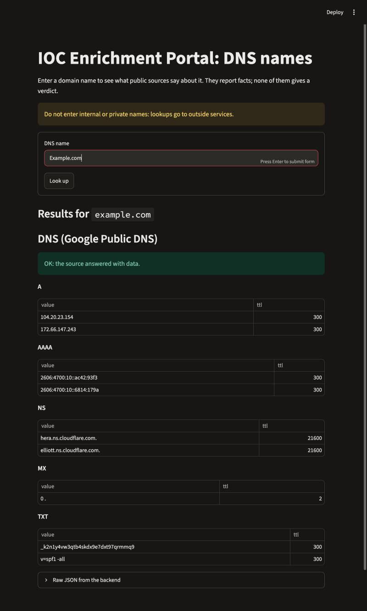

# Milestone log

## Milestone 0: design
- Pull request: #1 "Milestone 0: design.md for the simple IOC portal"

## Milestone 1: thinnest slice (Google DNS only)
- Branch: `feat/milestone-1`
- Source: Google Public DNS over HTTPS (keyless). Python 3.14.7, Flask 3.1.3, requests 2.34.2, Streamlit 1.67.0. No async anywhere.

### Definition of done (design.md section 9)
| Check | Result |
|---|---|
| Backend returns the source's data for a valid name, per the contract | yes, evidence 1 |
| An invalid name returns a clear error, not a crash | yes, evidence 3 |
| The page shows the result for a typed name, using only the backend | yes, evidence 2 |
| README explains install and run for both parts | yes |
| No key or token in any commit | none exist; the repository was scanned |
| Merged into `main` through a pull request | see the pull request below |

### Evidence 1: a real request and the JSON it returned
```
$ curl -s -i http://127.0.0.1:8010/api/v1/domain/Example.com      -> HTTP 200
```
```json
{
  "ioc": {
    "type": "domain",
    "input": "Example.com",
    "value": "example.com"
  },
  "sources": {
    "dns": {
      "status": "ok",
      "data": {
        "resolver": "dns.google",
        "rcode": "NOERROR",
        "A": [
          { "value": "104.20.23.154", "ttl": 300 },
          { "value": "172.66.147.243", "ttl": 300 }
        ],
        "AAAA": [
          { "value": "2606:4700:10::ac42:93f3", "ttl": 300 },
          { "value": "2606:4700:10::6814:179a", "ttl": 300 }
        ],
        "NS": [
          { "value": "hera.ns.cloudflare.com.", "ttl": 21600 },
          { "value": "elliott.ns.cloudflare.com.", "ttl": 21600 }
        ],
        "MX": [
          { "value": "0 .", "ttl": 121 }
        ],
        "TXT": [
          { "value": "_k2n1y4vw3qtb4skdx9e7dxt97qrmmq9", "ttl": 300 },
          { "value": "v=spf1 -all", "ttl": 300 }
        ]
      }
    }
  }
}
```
(Whitespace reformatted; values are exactly what the backend returned.)

### Evidence 2: the page, showing the same name


### Evidence 3: invalid names
```
$ curl -s -i http://127.0.0.1:8010/api/v1/domain/10.0.0.1          -> HTTP 400
{"error":"not a valid DNS name: 10.0.0.1 (IP addresses are not accepted)","input":"10.0.0.1"}

$ curl -s -i "http://127.0.0.1:8010/api/v1/domain/not%20a%20name"  -> HTTP 400
{"error":"not a valid DNS name: not a name (URLs, ports, e-mail addresses and spaces are not accepted)","input":"not a name"}
```
Also checked: a pasted URL, `localhost` and `example.123` all return 400; `Example.com` is cleaned to `example.com`; `bücher.de` becomes `xn--bcher-kva.de`;
an unknown route and an empty name return 404 in the same error format; a name that does not exist returns 200 with `"dns": {"status": "not_found"}`.

### A source that cannot be reached
Started with `DNS_URL=http://127.0.0.1:9/ BACKEND_PORT=8011 python -m backend.app` (an address where nothing listens): HTTP 502
`{"error":"all sources failed", ... "error":{"code":"upstream_error","message":"could not reach Google DNS: ConnectionError"}}`.

### Pull request
#2 "Milestone 1: thinnest slice (Google DNS, Flask backend, Streamlit page)": https://github.com/NewCooDooer/ioc-simple-dns/pull/2
